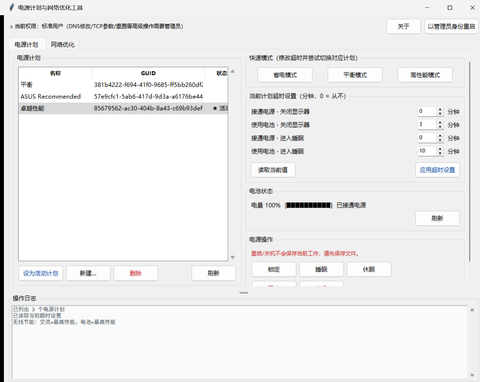

# PowerNetManager 电源计划与网络优化工具

Windows 桌面小工具：电源计划管理 + 网卡/网络诊断优化，纯 Python 标准库（tkinter）实现，无需第三方运行库。

## 功能

### ⚡ 电源
- 电源计划一键切换 / 新建 / 删除
- 显示器关闭、睡眠时间调节（接通电源 / 使用电池分别设置）
- 省电 / 平衡 / 高性能一键预设
- 睡眠、休眠、锁定快捷操作

### 🌐 网络
- 网卡状态查看（启用 / 禁用）
- IP / DNS / 网关 / 公网 IP 信息
- Ping 测速
- DNS 服务器一键切换
- TCP 全局参数优化
- Winsock / TCP 栈重置

部分操作（修改系统设置）需要**以管理员身份运行**。

## 截图

| 网络面板 | 网卡详情 |
| --- | --- |
|  |  |

## 直接使用（免安装）

到 [Releases](../../releases) 下载 `PowerNetManager.zip`，解压后运行 `PowerNetManager.exe` 即可。

## 从源码运行

需要 Windows 8+、Python 3.8+（tkinter 为标准库自带）：

```bat
python power_net_manager.py
```

## 自行打包

```bat
pip install pyinstaller
python build_exe.py
```

产物在 `dist/PowerNetManager/`（onedir 模式，含 `PowerNetManager.exe` 与 `_internal/`）。

## 许可

MIT
